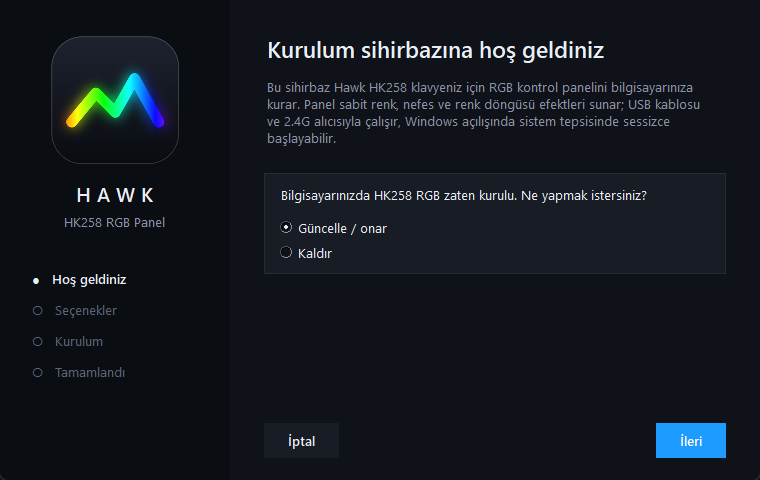

<p align="center"></p>

<h1 align="center">HK258 RGB</h1>

<p align="center">Hawk HK258 klavye için RGB kontrol paneli — resmi sürücüsü olmayan klavyeye tersine mühendislikle yazıldı.</p>

> **Resmi değildir.** Bu proje Hawk Gaming ile bağlantılı değildir ve onlar tarafından desteklenmez.
> Klavyenin USB protokolü, üreticinin yazılımı olmadığı için deneme yoluyla çözülmüştür. Kullanım riski size aittir.


## Özellikler

- **4 mod:** Sabit renk, Nefes, Renk döngüsü ve klavyenin kendi gökkuşağı efekti
- Renk çarkı, hazır renkler, hex kodu girişi, parlaklık ve efekt hızı ayarı
- Klavyenin canlı önizlemesi (LCD ekranı ve ses düğmesiyle)
- **USB kablosu ve 2.4G alıcısı** ile çalışır; kablo takılıp çıkarılınca kendiliğinden geçiş yapar
- Pil yüzdesi ve bağlantı türü göstergesi
- **Windows açılışında** sistem tepsisinde sessizce başlar; kapatınca tepside çalışmaya devam eder
- Tek kopya: uygulama zaten açıksa ikinci kez açılmaz, mevcut panel öne gelir
- Kurulum sihirbazı (kurma / güncelleme / kaldırma)

## Desteklenen donanım

| Bağlantı | USB kimliği | Not |
|---|---|---|
| USB kablosu | `1A2C:B007` ("Gaming keyboard", Shinetek Technology) | |
| 2.4G alıcısı | `1A2C:8FFF` ("2.4 Wireless Device") | Komutları klavyeye iletir |
| Bluetooth | — | Desteklenmiyor (denenmedi) |

Aynı Shinetek denetleyicisini kullanan başka klavyelerde de çalışabilir, ama denenmedi.

## Kurulum

### Seçenek 1 — Python ile (önerilen)

Gerekenler: Windows 10/11, [Python 3.12+](https://www.python.org/downloads/)

```bash
python -m pip install -r requirements.txt
```

Ardından **`HK258 RGB Kurulum.pyw`** dosyasına çift tıklayın. Sihirbaz uygulamayı
`%LOCALAPPDATA%\Programs\HK258 RGB` klasörüne kurar, masaüstü ve Başlat menüsü kısayolu oluşturur
ve isterseniz Windows açılışına ekler. Eksik paket varsa kendisi kurar.



Komut satırından: `python kur.py` (kurar) · `python kur.py --kaldir` (kaldırır)

### Seçenek 2 — Tek dosya kurulum exe'si

```bash
python -m pip install pyinstaller -r requirements.txt
python derle.py
```

`Dagitim\HK258 RGB Kurulum.exe` oluşur: Python gerektirmeyen, tek dosyalık kurulum programı.
Uygulamayı **Ayarlar → Uygulamalar** listesine de ekler, oradan kaldırılabilir.

> **Not:** Exe imzasızdır. Windows 11'de **Akıllı Uygulama Denetimi** (Smart App Control) açıksa
> çalışmaz — o bilgisayarlarda Seçenek 1'i kullanın. İnternetten indirilen kopyada SmartScreen
> "Ek bilgi → Yine de çalıştır" isteyebilir.

## Kullanım

- Paneli masaüstündeki **HK258 RGB** kısayoluyla açın.
- Pencereyi kapatınca uygulama **sistem tepsisinde** çalışmaya devam eder ve rengi korur.
  Tamamen çıkmak için tepsi simgesine sağ tıklayıp **Çıkış**'ı seçin.
- Uygulama kapanınca klavye ~3 saniye içinde kendi gökkuşağı efektine döner.
- Klavyede **Fn + Esc** fabrika ayarlarına döndürür.

Komut satırı (`hk258_rgb.py`):

```bash
python hk258_rgb.py kirmizi        # hazır renk (kirmizi, yesil, mavi, beyaz, mor, turuncu, sari, pembe, turkuaz, kapali)
python hk258_rgb.py ff8800         # hex renk
python hk258_rgb.py 255 136 0      # R G B
python hk258_rgb.py pil            # pil yüzdesi ve bağlantı türü
```

## Protokol (tersine mühendislik notları)

Klavye, HID arayüzü `MI_00` (Usage Page `0xFF02`, report ID'siz 64 baytlık giriş/çıkış raporları)
üzerinden komut alır. 2.4G alıcısının da aynı arayüzü vardır ve komutları klavyeye iletir.

```
aa 55 cc 33 | KOMUT | veri (59 bayt)
```

| Komut | Anlamı |
|---|---|
| `0x0E` | Pil sorgusu. Cevap: `aa 55 cc 33 0e <pil %> <bağlantı>` (kablo: `03`, 2.4G: `01`). Klavye bu paketi ~7 sn'de bir kendiliğinden de gönderir; 2.4G alıcısı sorguya cevap vermez, periyodik paket kullanılır. |
| `0x00`, `0xB5`, `0xF0`, `0xF1`, `0xF4` | Bu sırayla, aynı veriyle gönderilince klavye **sabit renk** moduna geçer. Renk verinin başından itibaren `R G B R G B …` olarak tekrarlanır. |

- Sabit renk modu **geçicidir**: ~3 saniye yeni komut gelmezse klavye kendi efektine döner.
  Bu yüzden program rengi her saniye yeniden gönderir (keepalive). Renk kalıcı belleğe yazılmaz.
- Nefes ve renk döngüsü efektleri programda hesaplanıp klavyeye sürekli gönderilir (~6 kare/sn).
- Diğer komutlar sessizce yok sayılıyor ya da görünür bir etki yapmıyor; tam liste bilinmiyor.

## Dosyalar

| Dosya | Açıklama |
|---|---|
| `hk258_rgb.py` | Sürücü: protokol, keepalive, pil takibi, komut satırı |
| `hk258_panel.py` | Panel uygulaması (pywebview), sistem tepsisi, tek kopya, Windows açılışı |
| `panel.html` | Panel arayüzü |
| `HK258 RGB Kurulum.pyw` | Kurulum sihirbazı (tkinter) |
| `kur.py` | Kurulum / kaldırma adımları |
| `derle.py` | Tek dosya kurulum exe'sini derler (PyInstaller) |
| `make_icon.py` | `app.ico` / `app.png` logosunu üretir |
